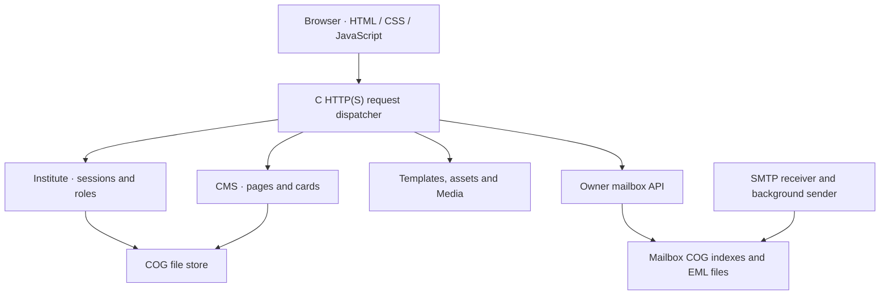

[README.md](https://github.com/user-attachments/files/34609008/README.md)
# LogOpposingOrbitalPromise

**A Windows-first C web framework with a native server console, a card-based CMS,
file-backed `.cog` storage, and an optional owner mailbox.**

| Project | Current implementation |
| --- | --- |
| Server executable | `PoolingArcSendSecret.exe` |
| Version | `0.1.5` |
| Languages | C17, HTML, CSS, JavaScript |
| Build | LLVM-MinGW UCRT x64, CMake, Ninja |
| Storage | Versioned `.cog` tables; `.eml` files for mail |
| TLS | Statically linked OpenSSL |
| Router integration | Statically linked MiniUPnPc |
| Runtime | A Windows console application with a normal C `main()` |

The project brings the website, content editing, account system, and server
operations into one native application. The browser provides the editing
interface; C owns routing, authorization, storage, networking, and mail.

**Status:** an actively developed first implementation. It is usable for
controlled development and integration testing, but it is not an audited
production CMS, a complete mail platform, or a hardened high-concurrency server.
The [current limits](#current-limits) describe the boundaries of this release.

## Contents

- [Quick start](#quick-start)
- [Project layout](#project-layout)
- [Build and dependencies](#build-and-dependencies)
- [Certificate setup](#certificate-setup)
- [Go Live and accounts](#go-live-and-accounts)
- [Console commands](#console-commands)
- [Configuration](#configuration)
- [Pages, cards, and templates](#pages-cards-and-templates)
- [Media library](#media-library)
- [Mail](#mail)
- [Public access and DNS](#public-access-and-dns)
- [COG storage](#cog-storage)
- [Architecture](#architecture)
- [HTTP interfaces](#http-interfaces)
- [Security model](#security-model)
- [Testing](#testing)
- [Troubleshooting](#troubleshooting)
- [Backups and upgrades](#backups-and-upgrades)
- [Current limits](#current-limits)
- [Development conventions](#development-conventions)
- [Dependencies and licensing](#dependencies-and-licensing)

## Quick start

### 1. Place the project

A typical installation uses these locations:

| Location | Purpose |
| --- | --- |
| `C:\ProofOrderObligedLog\LogOpposingOrbitalPromise` | Project root; contains `log.bat` |
| `C:\ProofOrderObligedLog\Net` | Shared, downloaded build dependencies |
| `C:\ProofOrderObligedLog\LogOpposingOrbitalPromise\Launch` | Published application and runtime data |

`Net` belongs **beside the project**, one directory above its root. It is not a
folder inside `LogOpposingOrbitalPromise`.

### 2. Build

On a Windows x64 machine with PowerShell and internet access, double-click
`log.bat` from the project root. From an existing PowerShell window, the
same action is:

```powershell
.\log.bat
```

If the server is already running, enter `exit` in its console first. The build
refuses to overwrite a locked executable.

The BAT provisions dependencies, compiles the complete C project, runs CTest,
checks static linking, checks the real TLS files, and publishes the release.
It does **not** start the server. A successful build removes `.build`.

### 3. Supply the TLS files

Use your existing files:

| File | Use |
| --- | --- |
| `LoveShip-chain.pem` | Full certificate chain for HTTPS and SMTP STARTTLS |
| `LoveShip-key.pem` | Matching private key |
| `LoveShip.pem` | Individual leaf certificate; retained if needed, but not the configured chain |

Put the chain and key together in either:

- `Launch\ssl`, the preferred runtime location; or
- the project root, beside `log.bat`.

The build supports both locations. See [certificate setup](#certificate-setup)
for the exact path rules.

### 4. Run

Double-click:

```text
Launch\PoolingArcSendSecret.exe
```

Approve the Windows elevation prompt. The executable opens its own interactive
console; no separate Command Prompt session is required. The header should show
**0.1.5**.

Open `http://localhost/` to test the HTTP listener. A quick PowerShell health
check is:

```powershell
Invoke-RestMethod http://127.0.0.1/api/health
```

For account setup, use an
HTTPS URL whose hostname is covered by your certificate, such as
`https://lovehive.org/` when that domain resolves to this server.

**Without valid TLS files:** HTTP on port 80 can still run, but owner setup,
login, account management, and mail remain unavailable over HTTP. The Go Live
page explains the TLS requirement. Fix the files or configuration and enter
`restart` in the console.

### 5. Create the owner

On first launch, read this file locally on the server:

```text
Launch\private\institute\setup.token
```

On the HTTPS site, click **Go Live**, choose and confirm your password, and enter
that one-time token. The owner username is **Sshhm**. Successful setup signs you
in and consumes the token.

There is no default owner password. Keep the setup token and private key out of
public pages, source packages, screenshots, and URLs.

## Project layout

Paths below are relative to the project root unless they begin with `../`.

| Path | Contents | Lifecycle |
| --- | --- | --- |
| `log.bat` | Build entry point and cleanup command | Source |
| `scripts/build.ps1` | Dependency bootstrap, build, checks, publishing | Source |
| `CMakeLists.txt` | Complete C target and test definitions | Source |
| `entry/main.c` | Standard C `main()` and application handlers | Source |
| `src/` | C implementation files | Source |
| `include/` | Public and internal project headers | Source |
| `entry/` | Website HTML, CSS, JavaScript, and shared assets | Source |
| `Media/index.html` | Media gallery page template | Source |
| `resources/` | EXE icon, resource script, administrator manifest | Source |
| `tests/` | C regression tests and optional JavaScript checks | Source |
| `.build/` | Compiler output, tests, temporary build-time tools | Removed after a successful build |
| `../Net/` | Shared toolchain, static libraries, receipts, archives | Retained between builds |
| `Launch/PoolingArcSendSecret.exe` | Published native server | Replaced by successful builds |
| `Launch/pool.conf` | **Only active runtime configuration** | Generated and updated by the build |
| `Launch/entry/` | Published website assets | Updated by builds |
| `Launch/Media/` | Gallery `index.html` and your public media files | User files retained |
| `Launch/ssl/` | Your certificate chain and private key | User-managed; not bundled |
| `Launch/private/institute/` | Accounts and initial setup token | Private persistent data |
| `Launch/private/cms/` | Published pages and cards | Private persistent data |
| `Launch/Mail/Sshhm/` | Owner mailbox, indexes, sender rules | Private persistent data |
| `Launch/tls-check.log` | Build-time check of the actual TLS files | Diagnostic output |

The EXE is a standalone native **server binary**, not a single-file bundle of
the website. Keep its configuration and runtime assets alongside it in `Launch`.
A bare EXE copied elsewhere does not carry the HTML, database, or certificates.

## Build and dependencies

### What `log.bat` does

1. Checks that the existing release EXE can be replaced.
2. Resolves the current release metadata for Ninja, CMake, and LLVM-MinGW.
3. Reuses installed versions when their recorded identity and required files
   match; otherwise downloads and stages replacements.
4. Installs prebuilt UCRT x64 static OpenSSL and MiniUPnPc packages, checking
   package SHA-256 values and recorded installed-file hashes.
5. Configures a fresh Ninja build, compiles all C targets, and runs CTest.
6. Inspects EXE imports to reject unexpected OpenSSL, MiniUPnPc, compiler-runtime,
   or MSYS dependency DLLs covered by the build's import check.
7. Updates `Launch/pool.conf`, locates the configured TLS pair, and runs a
   build-only probe against the **real** certificate and key.
8. Publishes assets and `PoolingArcSendSecret.exe`, then deletes `.build`.

A TLS-file warning is different from a compilation failure. Missing certificates
allow an HTTP-only startup; they do not make credentials safe to send over HTTP.

### Dependency locations

| Path relative to `Net` | Purpose |
| --- | --- |
| `bin/ninja/Ninja.exe` | Ninja executable |
| `bin/cmake/bin/` | CMake and CTest binaries |
| `bin/llvm-mingw/bin/` | LLVM-MinGW tools, including `x86_64-w64-mingw32-clang.exe` |
| `include/openssl/` | OpenSSL headers |
| `lib/openssl/` | `libssl.a`, `libcrypto.a` |
| `include/miniupnpc/` | MiniUPnPc headers |
| `lib/miniupnpc/` | Static MiniUPnPc library |
| `share/` | Package licenses and shared resources |
| `.versions/` | Installed-version identities and dependency receipts |
| `.cache/` | Downloaded archives and bootstrap cache |

Tool archives retain their vendor directory structure because their binaries
rely on relative paths. Junctions expose applicable include, library, and share
locations without duplicating large toolchain directories.

**No MSYS2 environment is installed.** MSYS2 is the origin of the prebuilt UCRT
library packages, not a requirement to install its shell, Pacman, Perl, or Make.
The bootstrap also removes recognized remnants of the older source-build setup.

Version receipts reduce repeated downloads; they are not a release lockfile.
The script still checks upstream metadata, so a warm dependency cache is not a
promise of a fully offline build. Tools can change between builds because
versions are selected dynamically. The current build selects **x86_64**; other
wrappers inside LLVM-MinGW do not constitute a tested ARM release target.

### Cleanup and failure behavior

```powershell
.\log.bat cleanup
```

The cleanup action removes recognized obsolete source-build tooling without
starting a compilation. It does not delete your application data.

On build or test failure, `.build` is retained for diagnosis. CTest details are
normally available under `.build/Testing/Temporary/LastTest.log`. A failed build
does not mean the existing release was updated; read the BAT's final result.

## Certificate setup

### Preferred configuration

With both files in `Launch/ssl`, the active configuration is:

```text
https_certificate /ssl/LoveShip-chain.pem
https_private_key /ssl/LoveShip-key.pem
```

`/ssl/` is an application shorthand for `Launch/ssl`, rather than an instruction
to use the Windows drive root first.

With both files directly in the project root, paths relative to `Launch` are:

```text
https_certificate ../LoveShip-chain.pem
https_private_key ../LoveShip-key.pem
```

The build recognizes that root pair automatically when migrating the default
configuration. Explicit complete paths are also supported:

```text
https_certificate C:/Certificates/LoveShip-chain.pem
https_private_key C:/Certificates/LoveShip-key.pem
```

Use a PEM chain whose leaf matches the PEM private key. Supply an unlocked key
for this implementation: background listeners do not wait for an interactive
password prompt. No self-signed certificate is silently generated.

### Resolution and migration rules

- Existing custom certificate paths are preserved by the build.
- The old `/ssl/LoveVessel-chain.pem` and `/ssl/LoveVessel-key.pem` default values
  are migrated to the LoveShip names.
- The configured `Launch` pair is preferred. For `/ssl` aliases, fallback is
  considered only when **both** configured files are absent.
- LoveShip files in the project root are recognized. Other supported `/ssl`
  locations include the project's `ssl` folder, its parent's `ssl` folder, and
  the current Windows drive's root `ssl` folder.
- A partial, unreadable, malformed, or mismatched configured pair is reported;
  a key from a different folder is not silently mixed into it.
- Private keys are not copied into the source release or between directories.

`Launch/tls-check.log` records whether the real pair could be loaded and matched.
This is separate from unit tests, which generate disposable test certificates.
It does not prove public reachability, browser trust, certificate renewal, or
hostname coverage. Browsing by a numeric IP can still produce a certificate-name
warning when the certificate covers domain names rather than that IP.

After changing certificate files or paths, enter `restart`. Renewal and
certificate issuance are currently external responsibilities.

## Go Live and accounts

### First-owner gate

Until an owner exists, resolved HTML pages show the Go Live interface instead
of unmanaged site content. The browser first checks whether HTTPS is available.
The setup form stays disabled when TLS is offline.

Owner setup requires the locally generated token, a chosen password, and
password confirmation. **Sshhm** is reserved and can be created as the owner
only through this one-time setup flow. Normal registration has no owner-token
field and cannot claim that account.

### Account workflow

`/Institute` contains separate Register and Login panels:

| Action | Required fields | Result |
| --- | --- | --- |
| Register | Login name, password, password confirmation | Creates a member and signs in |
| Login | Login name, password | Signs in to the existing account |
| Change password | Current password, new password, confirmation | Updates the hash and revokes all sessions |

The backend requires passwords of **15–128 bytes**. Usernames are normalized to
lowercase; the reserved owner's display name remains `Sshhm`.

After successful registration or login, the browser returns to the last safe
page visited in that tab. Signed-in visitors are redirected away from Institute.
The identity button becomes the bold username and opens `/acccount`; `/account`
is also supported. Login/Register navigation becomes Landing/Logout.

### Roles

| Role | Published content | Page/card management | Member administration | Owner mailbox |
| --- | --- | --- | --- | --- |
| Visitor | Read after Go Live | No | No | No |
| Member | Read | No | No | No |
| Moderator | Read | Yes | No | No |
| Owner / administrator | Read | Yes | Yes | Yes |

The owner can assign member/moderator roles and remove other members through
account management. The primary owner is protected from those removal actions.
Membership changes revoke all sessions, requiring users to sign in again.

Sessions have a fixed one-hour lifetime and are held in memory. They disappear
when the EXE process exits. The console's listener `restart` is different from
restarting the process and does not itself reset all account-session memory.
There is no self-service password reset, recovery-email flow, or MFA yet.

## Console commands

The command prompt remains above a separate scrolling log pane. Logs include
peer addresses, requests, response status/size, connections, and disconnections.

| Command | Behavior |
| --- | --- |
| `help` | Show supported commands and shortcuts |
| `start` | Start listeners using `pool.conf` when offline |
| `shutdown` or `stop` | Stop listeners; leave the console open |
| `restart` or `reload` | Stop and rebuild listeners using the latest configuration |
| `status` | Show HTTP, HTTPS, and SMTP state |
| `traffic` | Show request, error, byte, and uptime counters |
| `config` | Show configuration location and key listener settings |
| `ports open` | Request router mappings for the currently active listeners |
| `ports status` | Show router-mapping status |
| `ports close` | Close mappings tracked by this process |
| `logs on` / `logs off` | Enable or disable request/activity logging |
| `/wipe` or `wipe` | Clear visible log history and command residue |
| `exit` or `quit` | Stop the application and perform normal cleanup |

Commands are case-insensitive. Mouse wheel and Page Up/Page Down scroll the
buffered logs; Ctrl+End resumes following the newest entries. The in-memory log
buffer holds 1,024 lines.

`/wipe` does not delete accounts, cards, mail, or traffic counters. Starting a
new server instance through `restart` resets the listener's in-memory traffic
counters. Prefer `exit` before rebuilding: `shutdown` leaves the EXE process
running and can therefore leave the release file locked.

## Configuration

### One active file

The application changes its working directory to the EXE's directory and reads
`Launch/pool.conf`. Relative runtime paths therefore start from `Launch`, even
when the EXE was launched from a shortcut or another terminal directory.

The build archives an obsolete project-root `pool.conf` if one exists. Editing
that archived file does not change the running server.

### Syntax

Settings use a name followed by a value, not an equals sign:

```text
http_port 80
smtp_enabled true
```

Use `#` for comment lines. A semicolon introduces a variable definition, not a
normal comment. Variables must be declared before use:

```text
;CERT_DIR = /ssl
https_certificate ${CERT_DIR}/LoveShip-chain.pem
https_private_key ;{CERT_DIR}/LoveShip-key.pem
```

Both `${NAME}` and `;{NAME}` expansion forms are supported. Use bare values
without adding shell-style quotes. Put explanations on separate comment lines.
Unknown settings and invalid values produce line-numbered errors. Do not copy
unsupported settings from an older server configuration and assume they work.

### Runtime example

This is an example to adapt to your domains, not a promise that the build keeps
all manually edited network values unchanged:

```text
# Identity
hostname lovehive.org
domain lovehive.org
site_title Pooling Arc Send Secret
site_tagline Weave hopeful youth.

# Website
http_bind 0.0.0.0
http_port 80
https_bind 0.0.0.0
https_port 443
https_certificate /ssl/LoveShip-chain.pem
https_private_key /ssl/LoveShip-key.pem

# Optional inbound SMTP
smtp_enabled true
smtp_bind 0.0.0.0
smtp_port 25
smtp_max_size 26214400

# Router and Windows Firewall
upnp true
upnp_lease 3600
upnp_legacy_compat true
upnp_allow_permanent true
firewall true

# Local diagnostic DNS only
dns_enabled true
dns_bind 127.0.0.1
dns_port 53535
```

### Implemented settings

| Setting | Current behavior |
| --- | --- |
| `hostname` | Primary server identity and owner-mail domain |
| `domain` | Additional allowed domain; repeat for up to 16 aliases |
| `site_title`, `site_tagline` | Escaped site template text |
| `http_bind`, `http_port` | IPv4 HTTP listener; port 1–65535 |
| `https_bind`, `https_port` | IPv4 HTTPS listener; port `0` disables HTTPS |
| `https_certificate`, `https_private_key` | PEM chain/key paths |
| `smtp_enabled`, `smtp_bind`, `smtp_port` | Optional IPv4 receiver; port 1–65535 |
| `smtp_max_size` | Incoming message limit; 1,024–26,214,400 bytes |
| `upnp`, `upnp_lease` | Router-mapping enablement and requested lease; 600–86,400 seconds |
| `upnp_legacy_compat` | Allow Add-first behavior when ownership queries fail |
| `upnp_allow_permanent` | Allow permanent mapping fallback on router error 725 |
| `firewall` | Manage the application's Windows Firewall rules |
| `dns_enabled`, `dns_port` | Local diagnostic DNS listener |
| `dns_bind` | Must remain `127.0.0.1` for that diagnostic service |

**Accepted fields that do not yet provide their advertised control:**
`max_connections`, `max_per_ip`, `conn_rate_per_min`, `idle_timeout`,
`session_timeout`, `web_root`, `data_root`, `log_file`, and `smtp_spool`.

These are not effective hardening controls in this release. Website assets are
explicitly routed, account/CMS/mail locations are fixed, the HTTP socket timeout
is currently fixed at five seconds, and Institute sessions use their own fixed
one-hour lifetime. `log_file` does not turn the console history into a persistent
access log. Authentication's actual rate limiter is described separately below.

### What the build rewrites

The bootstrap reapplies its managed hostname, HTTP/HTTPS listener settings,
SMTP enable/bind/port settings, firewall/UPnP flags, and diagnostic DNS settings.
It adds the bundled domain list only if no `domain` entries are already present.
Other settings persist; custom TLS paths are preserved except for the explicit
old-default-name migration described above.

For changes that must survive rebuilding, adjust the ordered defaults/domain
list in `scripts/build.ps1`. For a runtime experiment, edit `Launch/pool.conf`
and use `restart`, remembering that the next build can reapply managed values.
The generated network defaults bind to all IPv4 interfaces; local-only testing
requires appropriate loopback binds and disabled public mapping after the build.

## Pages, cards, and templates

### Routes

| URL | Purpose |
| --- | --- |
| `/` | Landing page and workspace |
| `/maintenance` | Health, traffic, origin/response diagnostics, and managed extra cards |
| `/Institute` | Registration and login |
| `/acccount` | Account and owner member-management interface |
| `/account` | Supported account alias |
| `/Media` | Media gallery; `/Media/` and `/Media/index.html` also work |
| `/Mail` | Owner mailbox; `/Mail/Sshhm` also works |
| `/News`, `/Live`, or another created route | Published page using the shared template |

Created pages use extensionless URLs. A route name contains 1–40 ASCII letters,
digits, hyphens, or underscores. Built-in route names are reserved; use the
case of the created route consistently.

Page tabs wrap below the header and are sorted alphabetically in the browser.
Media also has its dedicated link beside Text size. The Mail navigation entry
is returned for the owner session. Theme, accent, and 8–20 px text preferences
are local to each browser; they are not a server-wide style change.

### Publishing workflow

1. Sign in as the owner or a moderator.
2. Use **Create page** at the right of the footer to create a route with its own
   heading, description, body, and workspace character.
3. Use **Create card** to add a category/label, heading, description, content,
   character, optional descriptive facts, and optional action link.
4. Save the card in the browser, review it, then choose **Publish workspace**
   beside Create card to commit the page's cards to server storage.
5. Use **Edit page** for page metadata. Published card controls read **Edit**
   and **Delete**; publish workspace changes to make them visible to visitors.

Cards appear side by side and expand across their workspace. Content grows to
its bounded height, then scrolls internally. Forms have fixed bounded widths,
auto-growing text areas, and no manual resizing. Page Body fields have a solid
border with opposite peel corners. The header keeps its rabbit; workspace/card
choices include Book, Canvas, Rabbit, and Star.

For descriptive boxes inside a card, enter one fact per line:

```text
Status | Online
Engine | PoolingArcSendSecret
Response | 5 ms
```

Maintenance has no Create page control. Authorized editors can append custom
cards after its built-in diagnostics and publish them.

Browser drafts are **not a durable backup or a second server database**. Loading
a published page can replace the browser's draft view with the server copy.
Publish before leaving important changes. Writes are last-save-wins; there are
no revisions, publishing history, merge handling, or conflict resolution yet.

### BBCode

| Markup | Rendering |
| --- | --- |
| `[b]text[/b]` | Bold text |
| `[i]text[/i]` | Emphasized text |
| `[u]text[/u]` | Underlined text |
| `[url]https://example.org/[/url]` | Clickable URL |
| `[code]literal text[/code]` | Preformatted block with a dotted border |
| `[quote]quoted text[/quote]` | Quote block with a dashed border |
| `[img]/Media/photo.png[/img]` | Framed image preview with filename and enlargement |
| `[video]/Media/clip.mp4[/video]` | Playable video preview |
| `[audio]/Media/song.mp3[/audio]` | Audio controls |

The compatibility closing form `[\img]` also works. The toolbar inserts supported
markup and small Unicode symbols/smilies. It is a bounded, flat BBCode parser,
not a complete nested BBCode engine; attribute forms such as `[url=...]` are not
implemented. It processes up to 50 matched blocks per content render.

Only relative or HTTP(S) media URLs are accepted. A video URL must point to a
playable media file, not a video-service HTML page. Raw HTML, scripts, iframes,
and `javascript:`/`data:` URLs are not interpreted. On HTTPS pages, browser
mixed-content rules can block external HTTP media.

### Template system

Server HTML templates currently expose:

```text
{{site.title}}
{{site.tagline}}
{{site.hostname}}
{{page.heading}}
{{page.subtitle}}
{{page.description}}
```

Values are HTML-escaped text. Use these placeholders in HTML text contexts,
not JavaScript, CSS, URLs, or event-handler attributes. Frontend components use
HTML `<template>` cloning, `textContent`, and DOM construction. Dynamic pages
reuse the landing template rather than generating a new physical HTML file.

## Media library

Place public media files directly in `Launch/Media`; the build updates its
`index.html` without deleting your files. Reload `/Media` to refresh the list.
There is no browser upload endpoint yet.

Supported gallery extensions are:

- Images: `.jpg`, `.jpeg`, `.png`, `.gif`, `.webp`, `.avif`.
- Video: `.mp4`, `.webm`, `.ogv`.
- Audio: `.mp3`, `.ogg`, `.wav`, `.flac`, `.m4a`.

Each item has its own preview and filename footer. Images open in an enlarged
viewer; video and audio can be enlarged, and music also has a Play/Pause button.
Playback depends on the browser's codec support.

The gallery lists up to 500 eligible files, each up to 64 MiB. It excludes
subdirectories, symlinks/reparse files, and unsupported formats. Single HTTP byte
ranges support seeking in media. Files can be requested through a simple path
such as `/Media/photo.png`, or the gallery's encoded-name endpoint:

```text
/Media/file?name=photo.png
```

Treat this folder as public website content. Mail and credential files belong
in their protected stores, not in Media.

## Mail

### Owner mailbox

Mail is optional and currently active only for **Sshhm**. Configured aliases such
as `Sshhm@lovehive.org` and `Sshhm@delicacy.diy` all lead to the same mailbox;
they are not separate accounts. Other members do not yet have mail activation.

Sign in over HTTPS and open `/Mail`. The interface provides:

| Folder | Meaning |
| --- | --- |
| Inbox | Accepted local mail |
| Sent | Messages accepted by the destination server or delivered locally |
| Archive | Mail moved out of the active inbox |
| Blocked | Messages from blocked senders or manually moved items |
| Outbox | Staged, failed, interrupted, or not-yet-confirmed outbound mail |

You can compose, read, move, archive, block/unblock senders, and permanently
delete messages. Reader previews show safe plain RFC 5322 source, capped at
128 KiB. Rich MIME HTML, extracted attachments, and inline attachment previews
are not implemented.

### Receiving

The optional receiver listens on TCP 25 and offers STARTTLS using the same
LoveShip certificate/key pair. Startup requires the HTTPS listener to be ready.
Recipients are deferred until the owner exists. Only configured local Sshhm
aliases are accepted; arbitrary relay destinations are rejected.

The receiver handles one SMTP connection at a time, one recipient per
transaction, bounded lines/messages, dot-stuffing, and a 120-second session
deadline. `smtp_max_size` defaults to 25 MiB. Blocked senders are routed into
Blocked rather than silently discarded.

**Inbound STARTTLS is offered, not mandatory for every remote SMTP sender.**
There is no public SMTP AUTH password listener. The Institute password is not
sent to an SMTP peer.

### Sending

Compose accepts one recipient and plain UTF-8 text. Non-ASCII subjects are MIME
encoded. Local owner aliases are delivered internally. External mail is staged
in Outbox and processed by a single background Windows sender, keeping the web
request handler available.

The sender resolves MX records, orders candidates by preference, uses IPv4/IPv6
connections to TCP 25, and requires verified STARTTLS. Destination certificate
hostname validation uses Windows trust roots imported into OpenSSL. There is
no plaintext delivery fallback. Up to three MX hosts can be tried before DATA
starts; once DATA starts, an automatic retry could duplicate a message and is
therefore avoided.

Only a final SMTP acceptance acknowledgement moves external mail to Sent.
**Sent means accepted by the next server, not guaranteed inbox placement.**
Delivery errors remain visible in Outbox. Retry is manual and asks for
confirmation because a broken connection can leave acceptance uncertain.
Interrupted sends are marked unknown on the next application launch.

The sender permits ten send/retry attempts per minute. An in-flight Outbox item
cannot be safely treated as a draft to move or delete. Exiting the process can
interrupt a background delivery; review its status before retrying.

### Mail storage and scope

| Path under `Launch/Mail/Sshhm` | Contents |
| --- | --- |
| `inbox/`, `sent/`, `archive/`, `blocked/`, `outbox/` | `.eml` message files |
| `mailbox.cog` | Message and folder index |
| `blocked.cog` | Blocked-sender rules |
| `delivery.cog` | Outbound delivery status |

The indexed mailbox is bounded to 500 messages and 256 MiB across its folders.
Permanent deletion provides a way to reclaim capacity. Older indexed
`private/mail` messages are migrated into the owner mailbox at startup.

Set `smtp_enabled false` to disable mail sending/receiving at runtime. The
CMake option `LOG_ENABLE_SMTP=OFF` builds the disabled receiver stub and disables
send operations. The stock BAT uses the default ON configuration; to make a
build-time choice persistent, adjust its CMake invocation.

This release does not provide submission on 587, IMAP/POP, external relay-provider
configuration, DKIM signing, bounce/DSN processing, production spam filtering,
or an automatic durable retry scheduler.

## Public access and DNS

Public service depends on several independent layers:

| Layer | What must work |
| --- | --- |
| Local listener | The console reports the specific protocol online |
| Windows Firewall | The EXE can receive traffic on its active ports |
| Router/NAT | Traffic reaches this machine's LAN address |
| ISP/upstream network | Inbound/outbound ports are permitted; a reachable public address exists |
| Public DNS | The domain resolves to this server; mail uses suitable MX/address records |
| TLS | The served certificate is trusted and covers the hostname used |

With `firewall true`, the elevated app manages program-scoped TCP rules. With
`upnp true`, it discovers a compatible gateway and requests mappings for active
HTTP, HTTPS, and SMTP listeners. A failed TLS listener is not advertised as an
active 443/25 mapping. Port numbers follow configuration, not a hardcoded promise
that every protocol is serving.

UPnP preserves mappings already aimed at this LAN host and refuses known mappings
to another device. Compatibility mode can attempt Add-first when ownership
queries are unavailable; this can replace a mapping whose target could not be
verified. Permanent fallback is available for routers returning error 725.
Permanent leases, failed readback, or forced termination can complicate cleanup.

Router acceptance is not proof that an outside client can connect. UPnP cannot
remove CGNAT, bypass an ISP block, or alter registrar DNS. Test from outside the
LAN; accessing your public IP from inside it can depend on router hairpin NAT.

For receiving mail at `Sshhm@lovehive.org`, configure that domain's mail routing
at the actual DNS provider and ensure its mail destination resolves to this
server. Merely pointing a website A record at the public IP is not a full mail
setup. External sending also depends on outbound TCP 25, remote-server policies,
and domain/IP reputation. SPF, DKIM, DMARC, and reverse-DNS work are not performed
by this application.

The built-in DNS component is a loopback-only, allowlisted **A lookup diagnostic**
on UDP `127.0.0.1:53535` by default. It uses the Windows resolver. It is not an
authoritative DNS server, a general recursive resolver, a dynamic-DNS updater,
or a replacement for registrar nameservers. Do not publish it as one.

## COG storage

`.cog` is the project's versioned table-file format and C CRUD interface. It is
not SQL, an executable scripting language, or a finished textual query language.
Each file contains one named table with unique keys and application-schema values.

An illustrative file is:

```text
COG 1
TABLE example
ROW 77656c636f6d65 48656c6c6f
```

This row maps `welcome` to `Hello`. Keys and values use hexadecimal encoding.
**Hex is encoding, not encryption.** The parser rejects malformed hex, NUL bytes,
duplicate keys, wrong table/version data, and oversized documents.

The API in [`include/cog.h`](include/cog.h) provides:

| Function | Operation |
| --- | --- |
| `log_cog_put` | Insert or upsert; `insert_only` rejects an existing key |
| `log_cog_get` | Query one key into a bounded buffer |
| `log_cog_scan` | Visit rows through a callback |
| `log_cog_remove` | Remove a row |

For example, from project C code:

```c
#include "cog.h"

static int save_example(void) {
    return log_cog_put(
        "private/cms/example.cog",
        "example",
        "welcome",
        "Hello",
        false
    );
}
```

Use trusted application-owned paths and check return values. Do not expose an
HTTP endpoint that accepts an arbitrary database filename.

| Persistent file | Purpose |
| --- | --- |
| `Launch/private/institute/members.cog` | Accounts, roles, salted password hashes |
| `Launch/private/cms/pages.cog` | Route metadata and published cards |
| `Launch/Mail/Sshhm/*.cog` | Owner mailbox indexes and sender rules |

COG files have a 512-row limit, 128-byte keys, 128 KiB values, and an 8 MiB file
limit. Writes use temporary replacement files and native replacement on Windows.
The mailbox adds synchronization for its HTTP/SMTP worker access. This remains a
bounded single-process store, without general multi-process transactions,
write-ahead logging, or proven power-loss recovery. Do not manually edit live
member or mail-index rows.

## Architecture



| Module | Responsibility |
| --- | --- |
| `entry/main.c` | Normal C entry point; console and top-level handlers |
| `src/entry.c`, `src/http.c` | Listener lifecycle, bounded HTTP parsing, routing, responses, metrics |
| `src/console.c`, `src/console_commands.c` | Interactive application control and command dispatch |
| `src/logging.c` | Colored console rendering and scrolling log history |
| `src/runtime_config.c`, `src/pool.c` | EXE-local configuration and parser |
| `src/tls.c` | Certificate resolution, TLS contexts, stream I/O, handshake diagnostics |
| `src/tls_probe.c` | Build-only check of real certificate files; not an extra release server |
| `src/assets.c`, `src/template.c` | Explicit asset serving and escaped HTML templates |
| `src/institute.c` | Owner setup, accounts, roles, sessions, password changes |
| `src/cms.c` | Published extensionless pages and card storage |
| `src/media.c` | Bounded public media listing and ranged file responses |
| `src/mail.c` | Owner mailbox storage, actions, and outbound worker coordination |
| `src/mail_transport.c` | Windows direct-MX SMTP delivery with verified STARTTLS |
| `src/smtp.c`, `src/smtp_policy.c` | Optional receiver and local-recipient policy |
| `src/cog.c`, `src/store.c`, `src/form.c`, `src/json.c` | Storage, filesystem protections, form decoding, JSON encoding |
| `src/ports.c`, `src/ports_policy.c` | UPnP leases, ownership, and compatibility decisions |
| `src/firewall.c`, `src/dns.c` | Windows Firewall integration and local DNS diagnostics |

The project compiles the listed modules into the static `log_core` library and
links the release EXE with its Windows resources. HTTP(S) request handling and
inbound SMTP each use a single worker; outbound mail has its own bounded worker.
There is no PHP runtime, framework application server, or Windows service
installation step.

## HTTP interfaces

Browser-facing routes are listed above. The principal API surfaces are:

| Method / endpoint | Purpose | Access |
| --- | --- | --- |
| `GET /api/health` | Native engine health response | Public diagnostic |
| `POST /api/echo` | Echo a diagnostic request body | Public diagnostic |
| `GET /api/metrics` | In-memory traffic totals | Loopback clients only |
| `GET /api/institute/status` | Owner-exists and HTTPS-ready state | Public bootstrap diagnostic |
| `GET /api/institute/session` | Current account, role, and CSRF token | HTTPS; valid session to authenticate |
| `POST /api/institute/setup` | One-time Sshhm creation | HTTPS, same Origin, setup token |
| `POST /api/institute/register` | Member registration | HTTPS, same Origin; owner must exist |
| `POST /api/institute/login` | Issue a session | HTTPS, same Origin |
| `POST /api/institute/logout` | Revoke the current session | Session and CSRF |
| `POST /api/institute/password` | Change password | Session, CSRF, current password |
| `GET/POST /api/institute/members` | List or administer members | Owner; CSRF for changes |
| `GET /api/routes` | Published navigation data | Public after Go Live; owner-only mail entry |
| `GET /api/pages?route=News` | Published page record | Public after Go Live |
| `POST /api/pages` | Create, save, or remove a page record | Owner/moderator, HTTPS session and CSRF |
| `GET /api/media` | Eligible media listing | Public after Go Live |
| `GET /Media/file?name=photo.png` | Media content; single byte-range support | Public after Go Live |
| `GET /api/mail/status` | Owner aliases and SMTP enablement | Owner over HTTPS |
| `GET /api/mail?folder=inbox` | Folder messages and delivery status | Owner over HTTPS |
| `GET /api/mail?id=...` | Bounded source preview | Owner over HTTPS |
| `GET /api/mail/blocked` | Blocked-sender list | Owner over HTTPS |
| `POST /api/mail` | Send, retry, move, delete, block, unblock | Owner over HTTPS, CSRF |

The browser session cookie is `__Host-pass`. The session endpoint returns the
current CSRF value for authorized browser requests; session credentials do not
belong in localStorage or example URLs.

Mutations use URL-encoded form fields. Authorized mutations carry
`X-CSRF-Token` and must pass Origin validation. Use the browser's account flow
rather than placing credentials or tokens in example command lines.

Page records are URL-encoded text, not a universal JSON API. These are evolving
project interfaces, not a versioned compatibility contract. Expected failures
include `403` for rejected authorization, `409` for setup/conflict conditions,
`426` for HTTPS-required account requests, `429` for rate limits, and `503` when
an operation is unavailable. A public diagnostic endpoint is not proof that
owner setup has completed.

## Security model

Implemented protections include:

- PBKDF2-HMAC-SHA256 password hashing with 600,000 iterations and per-account salts.
- Random session credentials; only their digests are retained server-side.
- `Secure`, `HttpOnly`, `SameSite=Strict`, host-only session cookies.
- HTTPS-only account/mail operations, Origin validation, and session CSRF tokens.
- Server-side role checks independent of hidden or disabled UI buttons.
- Shared in-memory credential-operation limits: ten attempts per tracked IP per
  minute and sixty globally, plus registration confirmation and a honeypot field.
- Escaped template values and DOM-built card/media content rather than raw HTML.
- Explicit asset paths and validated media/message identifiers.
- Windows ACLs restricting private account/CMS/mail stores to the runtime user,
  local Administrators, and SYSTEM; restrictive modes for portable storage tests.
- CSP, no-sniff, and response cache restrictions in the HTTP server.

Peer-address restrictions use the actual socket peer. Trusted reverse-proxy
header handling is not implemented: a proxy can make outside requests appear
to come from its local address. Do not treat the loopback metrics rule as
user authentication when adding a proxy.

The Windows manifest requests administrator rights for operations such as
Firewall management. It uses `uiAccess=false`; this is a console application,
not a desktop GUI or an installed background service.

These controls do not imply bot-proof registration, encryption of database/mail
files at rest, comprehensive antispam, hardened request concurrency, or an
independent security audit. The general network-limit configuration fields are
not substitutes for implemented enforcement. Be deliberate about exposing this
administrator-level development server to the public internet.

## Testing

`log.bat` runs the C tests before publishing. The current CTest suite covers:

| Area | Coverage |
| --- | --- |
| HTTP | Bounded parsing, duplicate headers, browser-style requests, Range header extraction |
| Configuration | Defaults, values, variables, invalid/unknown options |
| Console | Commands and aliases |
| Assets/templates | Route resolution, private-path rejection, escaping, required assets |
| TLS | Matching/mismatching keys, missing files, parent/root layouts, encrypted keys without prompting, stale errors |
| Router policy | Ownership and mapping decisions |
| COG | Insert, query, upsert, removal, validation |
| Institute/CMS | Setup, sessions, HTTP rejection, Origin/CSRF, roles, password changes, publication |
| Mail/media | Folder storage, blocking, migration, access guards, range reads, traversal rejection |

Mailbox route/storage tests use isolated authentication/transport doubles; real
session checks have their own suite. They are not a live external-mail delivery
test. Likewise, generated TLS test files are not your server's real certificate.
The build-only probe performs that separate real-file load/match check.

Optional frontend regression checks require a separately available Node.js;
Node is **not** installed or required by the normal server bootstrap:

```powershell
node --check entry/design.js
node --check entry/media.js
node --check entry/mail.js
node tests/appearance_test.js
node tests/setup_tls_test.js
```

Portable C and JavaScript checks have been exercised during development, and
the supplied LoveShip chain/key were verified to load and match in that
development environment. Native Windows console/UAC/ACL behavior, browser layout,
router behavior, public TLS trust, and live external SMTP delivery still require
integration checks on the target machine. Unit-test success does not establish
public reachability or production readiness.

## Troubleshooting

| Symptom | Check / action |
| --- | --- |
| Build refuses to replace the EXE | Enter `exit` in the old console; `shutdown` alone leaves the process open. Check for copied/pinned instances. |
| Console shows an older version | Launch the newly built `Launch/PoolingArcSendSecret.exe`; verify the `0.1.5` header and the BAT's publication result. |
| Tests pass but HTTPS is offline | Read `Launch/tls-check.log`. Test certificates and real runtime PEM files are different. |
| Log mentions `LoveVessel` instead of `LoveShip` | Run the updated BAT to migrate the old default paths; inspect custom paths in `Launch/pool.conf`. |
| `Cannot read certificate chain/private key` | Check the exact logged path, filename, permissions, and that both files are in the intended folder. |
| PEM cannot be loaded or key does not match | Use the matching chain/key pair; an encrypted key cannot be unlocked by an interactive background prompt. |
| HTTP works but Go Live is disabled | HTTPS must be online before setup; use `status`, fix TLS, then `restart`. |
| Browser certificate-name warning | Use a hostname covered by the certificate and correct DNS; matching a private key alone does not validate the URL hostname. |
| `Cannot bind ... (Winsock ...)` | Confirm the bind address belongs to this machine and another process is not listening on that port. |
| Public site fails although local HTTP works | Check active mappings, Firewall, LAN address, public DNS, upstream filtering, CGNAT, and an outside-LAN test. |
| Router query fails or reports 501/725 | Read the detailed UPnP log and review compatibility/permanent-lease settings; router firmware determines support. |
| Traffic card returns 403 | Open Maintenance through `127.0.0.1`; metrics are loopback-restricted. |
| `/api/health` shows JSON with browser controls | That endpoint is machine-readable JSON. Use the Maintenance health card for the styled view. |
| Login/register returns 426 | The request used HTTP; credentials must use valid HTTPS. |
| Account mutation returns 403 | Session may have expired or been revoked; sign in again and use the current Origin/CSRF context. |
| Registration returns 429 | Wait for the in-memory credential-operation rate window to clear. |
| A local card edit disappears | It was not published, or a later page load restored the server copy. Publish important edits before navigating away. |
| Media gallery is empty | Put supported files directly in `Launch/Media`, within the limits, then reload. Source `Media` and published `Launch/Media` are different folders. |
| Audio/video does not play | Check direct-file URL, browser codec support, size limits, and HTTPS mixed-content rules. |
| SMTP remains offline | HTTPS must have started successfully; check the receiver bind and port-25 diagnostics. |
| Incoming email does not arrive | Verify domain MX/address routing and public TCP 25 access; all accepted addresses must be configured Sshhm aliases. |
| Outbound message stays in Outbox | Read its delivery status. Check recipient MX, outbound TCP 25, verified STARTTLS, and recipient policy before retrying. |
| DNS bind fails | Keep the diagnostic service on loopback and an available non-conflicting UDP port; it is not needed to replace public DNS. |
| Configuration edit disappears after a build | The bootstrap reapplied a managed setting. Change its defaults for persistence across builds. |

When reporting a problem, include the version, relevant diagnostic lines, and
whether the failure is compilation, local listening, TLS loading, or public
reachability. Do not include the private key, setup token, session cookie, or
member database.

## Backups and upgrades

1. Let any important outbound send finish and enter `exit` for a consistent
   application-level snapshot and normal mapping/Firewall cleanup.
2. Back up the **entire `Launch` directory**, including `private`, `Mail`,
   `Media`, `pool.conf`, and `ssl`. If certificates are outside Launch, back up
   their location separately.
3. Extract source updates directly into the existing project root. Source-only
   update packages do not replace your runtime data.
4. Run `log.bat`, inspect its result and `tls-check.log`, then launch the new EXE.
5. Check `status`, a local health request, HTTPS login, and any services you use.

Do not delete `.cog` files to resolve ordinary startup or certificate errors.
Do not delete `Net` to clear website content: dependencies and runtime data have
different lifecycles. Keep a last-known-good source package and protected data
backup; there is no automatic rollback or database migration manager.

Restoring onto a different Windows account/machine also requires reviewing
filesystem access and certificates, not just copying a browser profile. Browser
appearance preferences and unpublished drafts are separate from server backups.

## Current limits

| Resource / behavior | Limit or boundary |
| --- | --- |
| Build target | Windows x64; UCRT toolchain/dependencies |
| Web listeners | IPv4; one HTTP(S) request handler at a time |
| HTTP connection | One request per connection; fixed five-second socket timeout |
| HTTP parser bounds | 16 KiB request/header budget and 1 MiB body budget |
| Accounts / in-memory sessions | 256 accounts; 128 session slots |
| COG | 512 rows; 128-byte keys; 128 KiB values; 8 MiB file |
| CMS | 1–40 character route names; bounded records; 100-card browser UI cap |
| Publication | Last-save-wins; no version history or conflict resolution |
| Media | 500 eligible files; 64 MiB each; no upload endpoint or recursive gallery |
| Mailbox | Owner only; 500 indexed messages; 256 MiB indexed content |
| Mail reader | 128 KiB source preview; no rich MIME/attachment interface |
| SMTP | One inbound connection worker; one outbound worker; one recipient per compose |
| Authentication | No recovery flow, email verification, MFA, or production bot-defense system |
| Deployment | Interactive elevated EXE; no service installer or unattended supervisor |
| DNS | Loopback diagnostic A lookups only |
| Recovery | Atomic replacement within a bounded store; no general transactional journal |

Priority development areas are durable storage/recovery, configurable enforced
connection limits, stronger abuse protection and account recovery, CMS revisions,
media uploads, richer MIME handling, mail authentication/delivery operations, and
repeatable Windows/browser/network integration testing. These are future work,
not capabilities implied by existing configuration names.

## Development conventions

- Keep C implementation in `src/*.c` and declarations in `include/*.h`.
- Use vertically readable formatting and bounded buffers; avoid giant embedded
  one-line HTML strings. Site templates belong in HTML files.
- Keep the root build entry point named `log.bat`; use the single PowerShell
  bootstrap instead of adding parallel setup scripts.
- Keep transient build output in `.build` and published runtime files in `Launch`.
- Validate route names, decoded forms, paths, lengths, and roles on the server.
- Add assets explicitly to serving/build rules; creating an arbitrary disk file
  does not automatically make it a public route.
- Keep COG and private mail behind their APIs, with application-owned paths.
- Treat client state as presentation/draft state, never as authorization.
- Preserve optional-module boundaries and static-library verification.
- Add regression checks for behavior changes; distinguish tests from live
  integration evidence and document any unsupported controls.

## Dependencies and licensing

| Dependency | Role | Upstream |
| --- | --- | --- |
| LLVM-MinGW | C compiler and Windows toolchain | [mstorsjo/llvm-mingw](https://github.com/mstorsjo/llvm-mingw) |
| CMake / CTest | Configure, generate, test | [Kitware/CMake](https://github.com/Kitware/CMake) |
| Ninja | Build executor | [ninja-build/ninja](https://github.com/ninja-build/ninja) |
| OpenSSL | TLS and cryptographic primitives | [openssl/openssl](https://github.com/openssl/openssl) |
| MiniUPnPc | Gateway discovery and port mappings | [miniupnp/miniupnp](https://github.com/miniupnp/miniupnp) |

Static library packages come from the MSYS2 UCRT64 package repository. Retained
package licenses are stored under `Net/share`. Static linking removes separate
project-library DLL deployment; normal Windows system DLLs remain dependencies.

A project-wide license has not yet been specified in this source tree. This
README does not assign one or replace the licenses of bundled dependencies.
